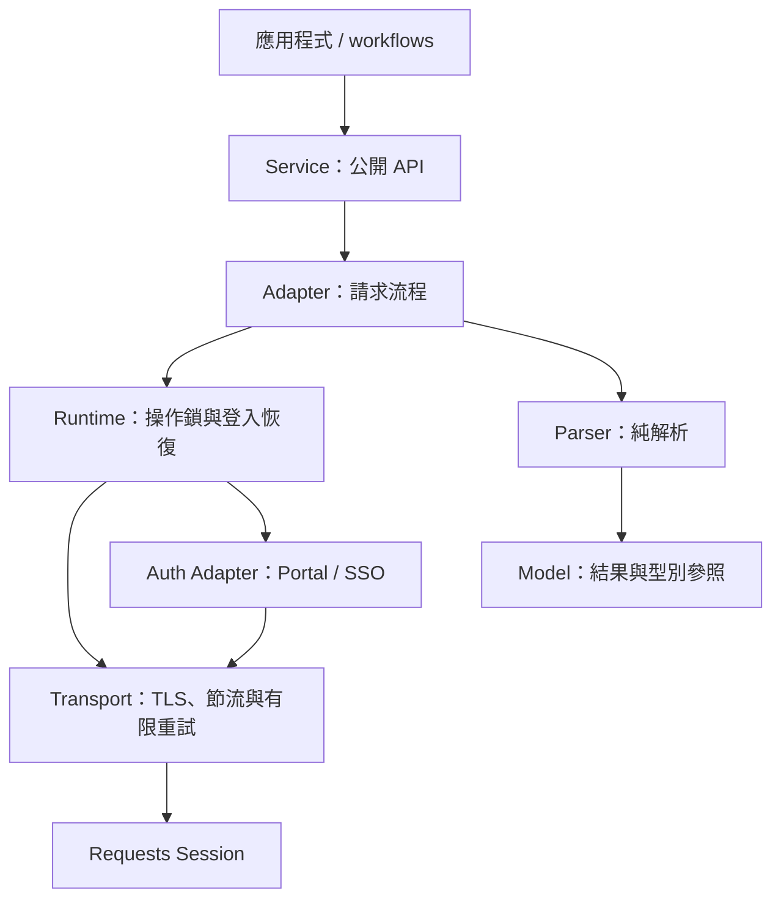

# SDK 架構

SDK 以 `VghksSDK` 組裝各領域 Service，共用一個有狀態的 Runtime／Session。應用程式與院內 EXE 使用同一份 API；多步驟任務由 workflow 組合。

## 一次查詢的流程

一個原子功能回傳一份有意義的結果，可以包含 SSO、病人 context 與必要分頁等多個 HTTP 請求。圖中箭頭表示執行流程；Runtime 透過 Protocol 使用登入能力，不匯入具體 Auth Adapter。

## 模組責任

下列路徑均相對於 `src/vghks_sdk/`。

| 模組 | 負責的事 |
| --- | --- |
| `sdk.py` | 組裝 Service／Adapter／Runtime、注入 transport、管理關閉與 context manager |
| `services/` | 公開用途、輸入檢查與型別回傳；透過 Adapter Protocol 呼叫 |
| `adapters/` | 各子系統的請求次序、表單／token、病人與就診 context；`auth.py` 管 Portal 與 SSO |
| `parsing/` | HTML／JSON／二進位純解析；靜態讀取已知 JS literal，不執行腳本 |
| `models/` | 資料模型、Filter、驗證與綁定病人／就診的 Ref |
| `runtime.py` | 完整操作鎖、登入／子系統恢復、寫入嘗試追蹤與操作診斷 |
| `core/` | 設定、錯誤、HTTP contract、Transport、TLS、節流、有限重試與診斷介面 |
| `queries.py` | 可發現的唯讀結果、輸入與 discovery 相依；動態呼叫既有 Service |
| `responses.py` | 可選的 JSON TypedDict 轉換；共用純 Parser，不發 HTTP、不改 Service 原回傳 |
| `acquisition.py` | 選用的統一結果與既有資料狀態評估；不新增 HTTP 或重試 |
| `search.py`／`workflows/` | 選擇資料來源、多步驟查詢、篩選、去重、錯誤續跑及階段存檔 |
| `contracts/` | HAR 契約及共用純證據規則，如登入證據、附件目錄與格式 |
| `live/`／`live_test_app.py` | SDK 的測試應用：計畫、採樣、錄製、coverage、結果 ZIP |
| `offline/` | 只讀 HAR／ZIP：重解析、完整性核對、恢復證據與重測設定 |
| `cli.py`／`__main__.py` | 命令列入口，依子命令呼叫查詢、workflow 或離線工具 |
| `local_io.py` | JSON／二進位原子寫入與本機檔案權限處理 |

PRQ 旗標／歷年清單的純解析集中於 `parsing/prq_extensions.py`，手術回覆判定位於 `parsing/oppl.py`。Adapter 與 offline 共用純函式；舊 Adapter 匯入保留相容入口。後續整理見 [OPTIMIZATION](OPTIMIZATION.md)。

`adapters/prq.py` 保留 `PrqAdapter` 組裝入口：`prq_context.py` 管共用病人／就診 context 與調閱審查，`prq_visits.py` 管就診／SOAP，`prq_orders.py` 管各類清單，`prq_assets.py` 管報告與附件。各組操作使用同一 Runtime，完整操作鎖與請求次序不變。

`adapters/auth.py` 保留 `AuthenticationAdapter` 與共用狀態：`auth_portal.py` 管 Portal 登入，`auth_sso.py` 管應用 SSO／簽到退入口，`auth_webmaas.py` 管頁面角色／表單與局部恢復，`auth_shared.py` 管 Session 型別、傳輸及來源驗證。所有組件使用同一 Session，原 `AppSession`／`SsoForm` 匯入仍可用。

## 領域與來源對照

| 公開 Service | 主要 Adapter／Parser | 領域文件 |
| --- | --- | --- |
| `auth` | `adapters/auth.py`；`parsing/portal.py`、`webmaas.py` | [連線與登入](CONNECTIONS.md) |
| `patients` | `adapters/webmaas.py`；`parsing/webmaas.py` | [病人與掛號](PATIENTS.md) |
| `opd`／`records`／`orders`／`medications` | `adapters/prq.py`、`prq_extensions.py`；`parsing/prq.py`、`prq_extensions.py`、`soap.py`、`clinical.py`、`report_data.py`、`scanned_records.py` | [就診](VISITS.md)、[SOAP](SOAP.md)、[數值](NUMERIC_REPORTS.md)、[掃描](SCANNED_RECORDS.md) |
| `surgery` | `adapters/oppl.py`、`surgery_cases.py`；對應 Parser | [排程](SURGERY_SCHEDULE.md)、[案例](SURGERY_CASES.md) |
| `reviews` | `adapters/review.py`、`review_auth.py`；`parsing/review.py` | [審查](REVIEWS.md) |
| `audit`／`earnings` | `adapters/audit.py`、`earnings.py`；`parsing/audit.py`、`documents.py` | [API](API_REFERENCE.md)、[連線](CONNECTIONS.md) |
| `personnel`／`attendance` | 各自的 Adapter／Parser | [人事](PERSONNEL.md)、[簽到退](ATTENDANCE.md) |

## 穩定邊界

- **兩種登錄各有用途**：`core/operations.py` 定義底層 HTTP method／path／異動屬性；`queries.py` 定義公開唯讀結果。兩者不是一對一，`queries.dependencies` 只供發現輸入，`queries.run` 不自動執行上游查詢。
- **Session 有共享狀態**：同一 SDK 的病人 context、HID、SSO 角色與 token 共用。Runtime 在完整操作期間持有 `operation_lock`；不同帳號各用獨立 SDK。維持預設 0.8–1.8 秒節流。
- **恢復有範圍**：可恢復的唯讀操作最多恢復一次；WebMAAS 明確 timeout 只重建原角色 SSO。登入拒絕、尚未登入與強制改密碼各自分類；密碼 POST、異動及已送出審查不能套用一般重播。TLS 政策由 `core/connections.py` 按來源共用，保留嚴格憑證模式。
- **參照綁定來源**：Adapter 先核對病人，再使用 VisitCase／Ref。歷史就診的 `mrn` 是明細來源號碼，`lookup_mrn` 是清單查詢號碼；下載驗證允許來源、路徑及病人，不接受任意 URL。
- **狀態保留差異**：合法空值、未執行、只有附件、部分解析與未知 schema 分開。Parser 保留來源及解析問題；PDF／JPG 成功下載不含 OCR，也不代表已取得醫療數值。
- **處置由應用決定**：`acquire`／`queries.run_result` 保留原回傳於 `value`；SDK 提供資料狀態與結構化原因，workflow 決定排程及續跑。外層 `retry_safe=False` 不能被底層網路原因覆蓋，見 [ACQUISITION](ACQUISITION.md)。
- **提交須保留邊界**：PRQ 遇已錄製的調閱審查頁，核對病歷號／HID／當頁選項後預設送一次 `1A`。手術經 SurgeryCommand；`attendance.punch` 明確呼叫才送出，且排除於唯讀目錄與 EXE。
- **診斷分兩層**：一般診斷保存有限結構欄位；raw capture 刻意保存完整內容。Portal 與 MIS 帳密分開；raw／parsed／ZIP 可能含個資，只留本機。

## 測試與離線資料流

`live → SDK → raw／parsed／journal → ZIP`；`offline → BundleReader → replay／contracts／完整性核對 → 分析報告與重測設定`。批次掛號在 `live/registrations.py` 逐人呼叫單筆 Service，Parser 不選下一名病人。

`live/profile.py` 編排 core／full；`live/steps.py` 共用結果、步驟記錄與逐步存檔，`live/patient.py` 處理逐次就診、歷年清單與本機搜尋。其他專項直接使用共用 steps，舊 profile 匯入仍可用。

離線職責分開：`analyze.py` 組裝報告、`evidence.py` 彙整安全摘要及問題分類、`presentation.py` 呈現／比較已組裝報告；`replay.py` 重解析、`assets.py` 核對存檔、`pacs.py`／`registrations.py` 核對專項、`session.py`／`recovery.py` 核對 Session 與恢復、`retest.py` 產生設定。舊 analyze 匯入保留；登入證據與附件契約仍由 `contracts/auth_evidence.py`、`order_assets.py` 共用。

`offline/cache.py` 只在單次 ZIP 分析內共用 JSON 與請求解析，結束或失敗即清除；目錄、自訂 Reader 與二進位仍直接讀取。`requests.py` 預建唯讀操作簽章，請求形狀快取只存解析所需欄位。`BundleReader.json`／`jsonl` 的公開新值語意保留，快取不跨分析或 SDK Session 共用。上限與量測見 [OPTIMIZATION](OPTIMIZATION.md)。

恢復判定需以 `capture_operation_id` 對到同一次 raw 操作並核對完整次序。重解析、附件核對與原始實測各自保留，後續成功不覆寫原 ERROR；NO_SAMPLE 保留缺口，見 [VALIDATION](VALIDATION.md)。

一般 import／建構 SDK 不發網路；一般 SDK import 不載入 live／offline 執行流程。`live` 公開匯出按需載入，offline 可讀 `live.config`，不因此載入測試 runner。

## 擴充與相容性

新增功能依序接 Model → Parser → HTTP contract／Adapter → Service／Protocol → QuerySpec／discovery／offline replay，並更新 API generator。流程見 [DEVELOPMENT](DEVELOPMENT.md) 與 [HAR_RECORDING](HAR_RECORDING.md)，組合範例見 [COMPOSITION](COMPOSITION.md)。

版本唯一來源為 `_version.py`；`build_info.py` 記錄建置資訊。`operation_models.py` 保留舊匯入，新程式從 `models` 匯入；`py.typed` 隨 wheel 發布。公開 Service、CLI 與相容入口的變更需保留回歸測試，後續整理順序見 [OPTIMIZATION](OPTIMIZATION.md)。
